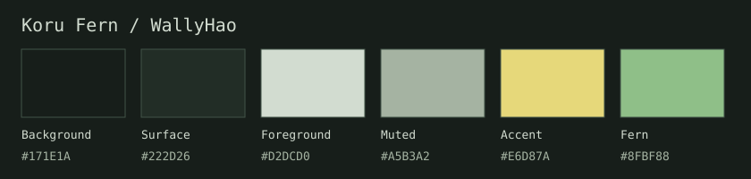

# Fedora + MangoWC · Koru Fern

Fedora 44 / MangoWC 0.18.0 的个人桌面配置快照。深绿灰底色、柔和黄色重点、蕨绿色辅助强调，主要界面使用直角和不透明背景。保留现有窗口动画和 Ghostty 光标着色器。

**配色来源：WallyHao 的 [koru-nixos-dotfiles](https://github.com/WallyHao/koru-nixos-dotfiles)，原版 Koru Fern 色板。**
参考提交：[b276a4a](https://github.com/WallyHao/koru-nixos-dotfiles/tree/b276a4a61197b7831fbbe2e44af418a3b19ae768)，色板定义见 [system/theme.nix](https://github.com/WallyHao/koru-nixos-dotfiles/blob/b276a4a61197b7831fbbe2e44af418a3b19ae768/system/theme.nix)。本仓库将其适配到 Fedora 与 MangoWC，配色并非本仓库原创；不需要 NixOS 或 Home Manager。



| 颜色角色 | 色值 |
| --- | --- |
| 背景 / 浮起表面 | `#171E1A` / `#222D26` |
| 主文字 / 次级文字 | `#D2DCD0` / `#A5B3A2` |
| 黄色重点 / 蕨绿色强调 | `#E6D87A` / `#8FBF88` |
| 边框 / 选区 | `#425347` / `#334936` |

完整语义色与 16 色 ANSI 色板见 [system/theme.json](system/theme.json)。其他资源来源和许可见 [CREDITS.md](CREDITS.md)。

## 仓库结构

参照上游 Koru 的目录职责组织；配置内容采用 Fedora 原生格式。

```text
home/       应用配置与应用主题
system/     统一 Koru Fern 色板（theme.json）
assets/     Bibata 光标与 Fcitx5 独立主题资源
hosts/      本机屏幕、字体和会话说明
lib/        部署映射与导出文件校验清单
scripts/    路径渲染、光标重着色工具
licenses/   第三方许可
docs/       色板预览与 Fcitx5 验证记录
```

## 收录范围

| 组件 | 配置位置 | 内容 |
| --- | --- | --- |
| MangoWC | `home/mango/` | 合成器、快捷键、窗口规则、屏幕、启动脚本及工具脚本 |
| Bibata 光标 | `assets/cursors/Bibata-Modern-Koru/` | Koru 重着色、原始尺寸与热点、别名、上游 GPL 许可 |
| Rofi | `home/rofi/` | 启动器及完整 Koru Fern 主题 |
| Ghostty | `home/ghostty/` | 字体、窗口、Koru Fern 色板、现有光标着色器 |
| Alacritty | `home/alacritty/` | 当前终端配置及 Koru Fern 色板 |
| Helix | `home/helix/` | 编辑器、语言配置及 Koru Fern 语法主题 |
| Yazi | `home/yazi/` | 界面主题、文件图标规则及预览语法色板 |
| Btop | `home/btop/` | 当前配置及 Koru Fern 图表主题 |
| SwayNC | `home/swaync/` | 通知面板、JSON、CSS、现有声音与脚本 |
| Swaylock | `home/swaylock/` | 锁屏及 Koru Fern 配色 |
| Fcitx5 | `home/fcitx5/conf/classicui.conf`、`assets/fcitx5/koru-fern/` | 当前 Classic UI 配置快照与独立候选框主题 |

Rime 的方案、词库、学习记录和用户数据库不上传。密钥、登录信息、应用运行状态、剪贴板记录、备份、旧主题及嵌套 Git 仓库不收录；本机现有文件和旧主题仍保留。

## 硬件与现有行为

这是一套针对 **3200×2000、165 Hz、Mango Scale=2** 的配置，屏幕名称为 `eDP-1`，Xft DPI 为 192。移植到其他设备前检查 `monitor.conf` 和 `autostart.sh`，不要照搬 DPI 来修补外观。

字体文件不随仓库分发：终端使用 `Jetbrains Maple Mono`（Ghostty 16 / Alacritty 13），Rofi 使用 `HarmonyOS Sans bold 18`，Fcitx5 使用 `HarmonyOS Sans 12`、菜单 10。需要自行安装相应字体及终端图标字形。

常用快捷键：`Super+Space` 启动器，`Super+H/J/K/L` 聚焦，`Super+U/I` 工作区，`Super+R` 列宽预设，`Super+Shift+S` 截图，`Super+V` 剪贴板，`Super+Alt+L` 锁屏，`Super+Alt+R` 重载 Mango。完整绑定以 `bind.conf` 为准。

启动脚本会复用现有 Fcitx5 等进程，Mango 服务采用会话锁避免重复启动；夜灯保留 4200K。配置所需工具包括 `rofi`、`swaync`、`swaylock`、`fcitx5`、`xrdb`、`dconf`、`wl-clipboard`、`cliphist`、`flock`、`wlsunset`、`brightnessctl`、`wpctl`、`playerctl`、`grim`、`slurp`、`jq`、`wlr-randr`、`sox`。`satty`、`swayosd-server`、`sway-audio-idle-inhibit`、`xfce-polkit` 按需安装，启动脚本会跳过未安装的可选服务。输入法继续使用既有 Fcitx5 + Rime。

## 使用与恢复

仓库用于保存和审阅配置，**不会自动修改当前桌面**。本机已使用这套配置，无需重新安装。移植时先备份原配置，再按组件挑选文件；不要把整个目录直接覆盖到另一个用户的 `~/.config`。

少数原配置使用绝对路径，导出时统一替换为 `@HOME@`。先生成适合当前用户的副本：

```sh
python3 scripts/render.py --output /tmp/koru-fern-ready
```

脚本只写指定的新目录，将 `@HOME@` 替换为当前用户的家目录，并保留可执行权限和光标符号链接。不同目标用户可加 `--home /home/目标用户`。生成的 `.config/`、`.local/` 目录按组件复制即可；渲染前的模板不可直接启用。目录部署映射见 `lib/deployment.json`。

Mango 的光标通过其专用 Dconf profile 配置，保留 `cursor/dconf-profile`、`koru-cursor.db` 和 `dconf.d/` 一起使用。需要重建数据库时，在渲染后的 Mango 目录运行：

```sh
dconf compile cursor/koru-cursor.db cursor/dconf.d
```

回滚各应用时恢复自己的配置备份。仓库只包含 Koru Fern 资源，原有 Kanso Ink 等主题继续留在本机。

### 仅应用 Fcitx5 主题

Fcitx5 本机版本为 5.1.23，实际用户界面是 Classic UI。**不要整体覆盖 `classicui.conf`**：仓库中的文件仅作为现有状态参考，它包含本机字体、候选方向和 DPI 参数。将独立主题复制到用户主题目录，仅修改 `Theme`、`DarkTheme`：

```sh
mkdir -p ~/.local/share/fcitx5/themes
cp -a assets/fcitx5/koru-fern ~/.local/share/fcitx5/themes/
cp -a ~/.config/fcitx5/conf/classicui.conf ~/.config/fcitx5/conf/classicui.conf.before-koru-fern
sed -i -E 's/^(Theme|DarkTheme)=.*/\1=koru-fern/' ~/.config/fcitx5/conf/classicui.conf
gdbus call --session --dest org.fcitx.Fcitx5 --object-path /controller \
  --method org.fcitx.Fcitx.Controller1.ReloadAddonConfig classicui
```

以上切换命令适用于已经存在 `Theme`、`DarkTheme` 项的配置；缺少时手动添加这两项。候选框使用原生纯色绘制，只有两个 8×8 PNG 菜单图标，无 SVG、阴影或模糊。主题文件所有字段置于节内，以兼容 GTK 客户端解析器。

本机保留 `PerScreenDPI=True`、Wayland DPI 默认值 0、分数缩放默认启用。当前版本没有有效的 `ScaleWithDPI` 配置项，主题使用隐式 `SupportedScale=1`。不改 Rime、字体、输入法快捷键、分页、预编辑行为或协议环境变量。

回滚到本机此前的候选主题：

```sh
sed -i -E 's/^(Theme|DarkTheme)=.*/\1=mellow-graphite-obsidian-lite/' ~/.config/fcitx5/conf/classicui.conf
gdbus call --session --dest org.fcitx.Fcitx5 --object-path /controller \
  --method org.fcitx.Fcitx.Controller1.ReloadAddonConfig classicui
```

其他机器使用自己的原主题名，或恢复 `classicui.conf.before-koru-fern`。部分应用缓存主题，切换后需重新打开应用。

## GNOME 共存与已知限制

Mango 光标 profile 由 Mango 会话指定，不修改 GNOME 的全局光标配置。Fcitx5 配置由两个会话共享，**Fcitx5 主题没有会话隔离**。GNOME Kimpanel 通常由 Shell 绘制候选框；Classic UI 回退或客户端绘制可能应用本主题。终端、编辑器等用户配置也按应用共享，不能假设它们只影响 Mango。

本机 XWayland 光标路径仍可能把 24 px 光标放大，清晰度与原生 Wayland 存在差异，未宣称修复。Fcitx5 候选框已验证的输入和定位结果见 [docs/fcitx5-validation.md](docs/fcitx5-validation.md)；不是所有应用或长期运行的兼容性保证。

导出整理包括个人路径模板化及尾随空白清理，并在仓库副本修正通知完成音脚本的文件引用（`complete.oga` → 已有的 `complete.ogg`）。这些整理未修改本机运行配置。
